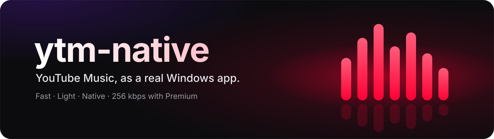
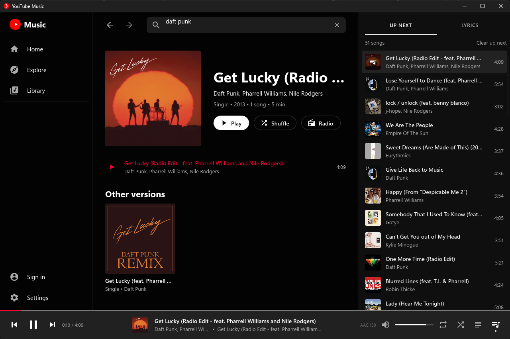
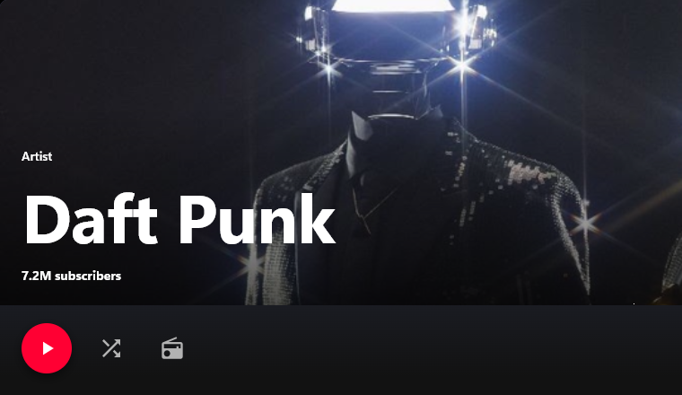
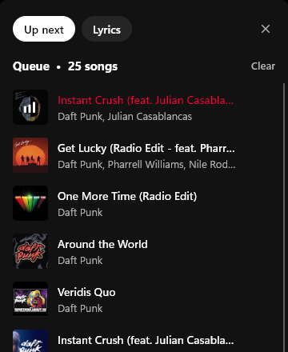
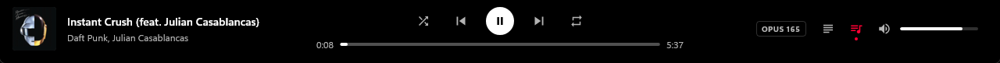

<div align="center">



### Fast, light and fully native. No browser tab, no Electron, just music.

[](https://github.com/Visxoz/ytm-native/releases/latest)
[](https://github.com/Visxoz/ytm-native/releases)
[](https://github.com/Visxoz/ytm-native/actions/workflows/ci.yml)
[](#install)
[](#under-the-hood)
[](LICENSE)

<br>

<a href="https://github.com/Visxoz/ytm-native/releases/latest"></a>

<br><br>



</div>

## Features

- **Light.** Starts in a moment and stays around 160 MB while you browse. No runtime to install, and nothing left running in the background.
- **Sounds better.** The best stream YouTube offers, **256 kbps Opus** with Premium, or a lower quality when data is dear. Gapless playback or crossfade, and loudness levelling.
- **Plays like YouTube Music.** Search finds songs and uploads alike, radio and autoplay keep going, Smart Shuffle mixes recommendations into your playlists, and shuffle, repeat, play next, history and the queue all work as you'd expect.
- **Feels at home.** A clean dark interface with headers tinted from the artwork, a collapsible library, smooth animations, and lyrics a click away.
- **Made for Windows.** Media keys, the Windows media overlay, Discord status, and a window that remembers where you left off, down to the song and position.
- **Your library, safely.** Sign in on Google's own page for your playlists, albums, artists and Liked music. The sign-in is stored encrypted, for your Windows account only.

<p align="center">
  
  
  <br>
  
</p>

## Install

Grab one from the [latest release](https://github.com/Visxoz/ytm-native/releases/latest):

- **`ytm-native_<version>_x64-setup.exe`**: installs for your account only, with no admin prompt, a Start menu entry and an uninstaller.
- **`ytm-native_<version>_x64-portable.exe`**: put it anywhere and run it; nothing is installed.

Either way the app keeps itself up to date. When a new version is out, a dot appears on the account button, and **Settings ▸ Updates** installs it and restarts. Each download is checked against the release's SHA-256 checksums first.

> [!NOTE]
> The app isn't code-signed yet, so SmartScreen may say it "protected your PC": choose **More info**, then **Run anyway**. If Smart App Control blocks it, right-click the file, choose **Properties**, tick **Unblock**, and run it again.

## Shortcuts

<kbd>Space</kbd> play or pause &nbsp;·&nbsp;
<kbd>Ctrl</kbd> <kbd>K</kbd> search &nbsp;·&nbsp;
<kbd>Ctrl</kbd> <kbd>B</kbd> library &nbsp;·&nbsp;
<kbd>Ctrl</kbd> <kbd>←</kbd> <kbd>→</kbd> previous or next song &nbsp;·&nbsp;
<kbd>Alt</kbd> <kbd>←</kbd> back

Right-click a song to play it next, add it to the queue, start a radio, or go to its artist or album.

## Signing in

Choose **Sign in**, then **Sign in with Google**, and sign in on Google's page as usual. The window closes by itself once you're in. It uses Microsoft Edge WebView2, which comes with Windows 11 and most Windows 10 PCs.

<details>
<summary><b>Prefer pasting cookies?</b></summary>
<br>

Open music.youtube.com in a private browser window and sign in. Copy either a cookies.txt export or the `Cookie` request header from the developer tools (Network tab), paste it under **Paste cookies instead**, and close the private window. YouTube rotates the cookies of sessions that stay open.

</details>

> [!WARNING]
> ytm-native is an unofficial client. It uses YouTube's undocumented API, which is against YouTube's terms of service. Google could ask you to confirm you're not a bot or sign the session out, and could in principle restrict the account. A separate account is the safest choice.

## Under the hood

<details>
<summary><b>How it works</b></summary>
<br>

The interface, the player and the audio pipeline are all native Rust. A browser engine only appears while you sign in, to show Google's page.

- **YouTube Music data** (search, pages, radio, lyrics, library): [rustypipe](https://codeberg.org/ThetaDev/rustypipe)
- **Stream URLs**: YouTube's player endpoint, called directly (`src/streams`)
- **Demuxing and AAC**: [Symphonia](https://github.com/pdeljanov/Symphonia)
- **Opus**: libopus 1.3.1, as Rust ([unsafe-libopus](https://crates.io/crates/unsafe-libopus))
- **Audio output**: [cpal](https://github.com/RustAudio/cpal), through WASAPI
- **Interface**: [Slint](https://slint.dev), drawn by Skia on the GPU through Direct3D 12
- **Networking**: reqwest over Windows SChannel and HTTP/2
- **Google sign-in**: WebView2 through [wry](https://github.com/tauri-apps/wry), only while signing in
- **Media keys**: [souvlaki](https://github.com/Sinono3/souvlaki)

Most YouTube clients get stream URLs scrambled by YouTube's player JavaScript. The visionOS client gets plain ones, so the app asks as that client and needs no JavaScript engine, falling back to Android VR and iOS if YouTube changes it. With Premium, the app unscrambles the web player's URLs itself, in a short-lived QuickJS context with a cut-down copy of the player.

Streams download in ranges and are decoded in the app, and the next song's stream is looked up ahead of time. Skia draws on the GPU, so scrolling costs little CPU, and animations only run while something changes.

</details>

<details>
<summary><b>Building from source</b></summary>
<br>

You need Rust with the MSVC toolchain. Three crates are built from `vendor/` with a patch from `patches/` applied, so vendor them once after cloning, and again after updating Slint or rustypipe:

```powershell
./scripts/vendor-patched.ps1
```

```powershell
cargo run              # debug build with logging
cargo build --release  # target/release/ytm-native.exe
cargo test
```

The patches:

- `i-slint-common` memory-maps the fallback fonts instead of reading them into memory, which saves about 18 MB.
- `i-slint-renderer-skia` draws fallback fonts for CJK and emoji from those mappings instead of private copies.
- `rustypipe` opens playlists the signed-in user owns, and returns an error instead of crashing when YouTube refuses a visitor ID.

Settings, caches and your sign-in live in `%APPDATA%\ytm-native`; the sign-in is encrypted with Windows' DPAPI. `YTM_LOG=info` turns on logging in release builds.

</details>

## Licence

ytm-native is free software under the [GNU General Public License, version 3](LICENSE). It builds on [rustypipe](https://codeberg.org/ThetaDev/rustypipe), which is GPL-3.0, and on [Slint](https://slint.dev) under its GPL-3.0 option.

<br>

<div align="center">
<sub>Not affiliated with, endorsed by or connected to YouTube or Google. YouTube Music is a trademark of Google LLC.</sub>
</div>
