<div align="center">


<br>

[](https://github.com/Visxoz/ytm-native/releases/latest)
[](https://github.com/Visxoz/ytm-native/releases)
[](https://github.com/Visxoz/ytm-native/actions/workflows/ci.yml)
[](#install)
[](#under-the-hood)
[](LICENSE)

<br>

<a href="https://github.com/Visxoz/ytm-native/releases/latest"></a>

<br>

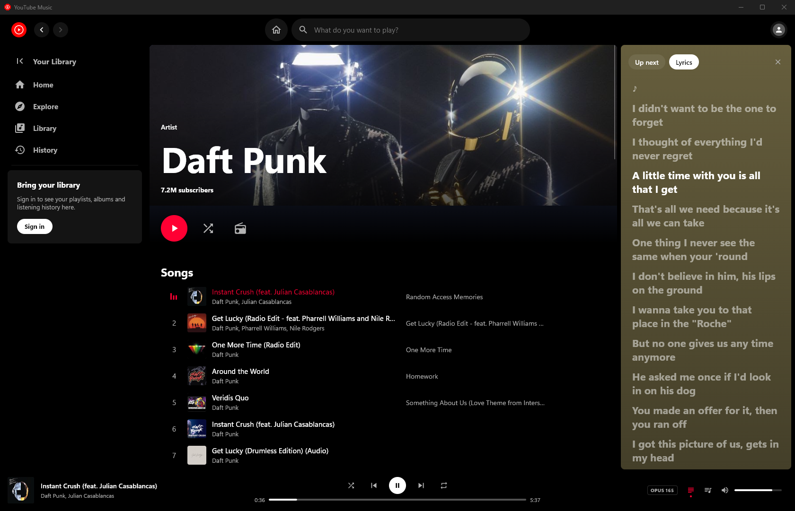

<sub>Black look · lyrics that follow the song, tinted from its artwork</sub>

<br><br>

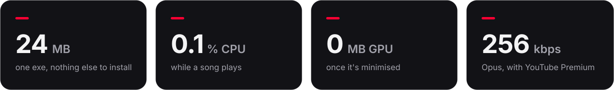

</div>

<br>

<table>
<tr>
<td width="33%" valign="top">

### Sounds better
256 kbps Opus with Premium, gapless playback, a 6-second crossfade, volume levelling and a six-band equaliser.

</td>
<td width="33%" valign="top">

### Weighs nothing
One 24 MB exe, drawn by the GPU, using 0.1% of the CPU while it plays. Minimised, it hands back its GPU memory and drops to about 41 MB of RAM.

</td>
<td width="33%" valign="top">

### Looks the part
Dark, light or pure black, in seven accents, or one that follows the song's artwork. Pages are tinted to match.

</td>
</tr>
<tr>
<td width="33%" valign="top">

### Plays like YouTube Music
Radio, autoplay, Smart Shuffle, repeat, history and search with recent searches. Artist pages carry the whole discography.

</td>
<td width="33%" valign="top">

### Lyrics and queue
Synced lyrics you can click to jump to. A queue you drag into order, edit several songs at a time, and save as a playlist.

</td>
<td width="33%" valign="top">

### At home on Windows
Media keys, the Windows media overlay, Discord, Last.fm. Reopens on the song you left, at the second you left it.

</td>
</tr>
</table>

## Make it yours

<table>
<tr>
<td width="50%">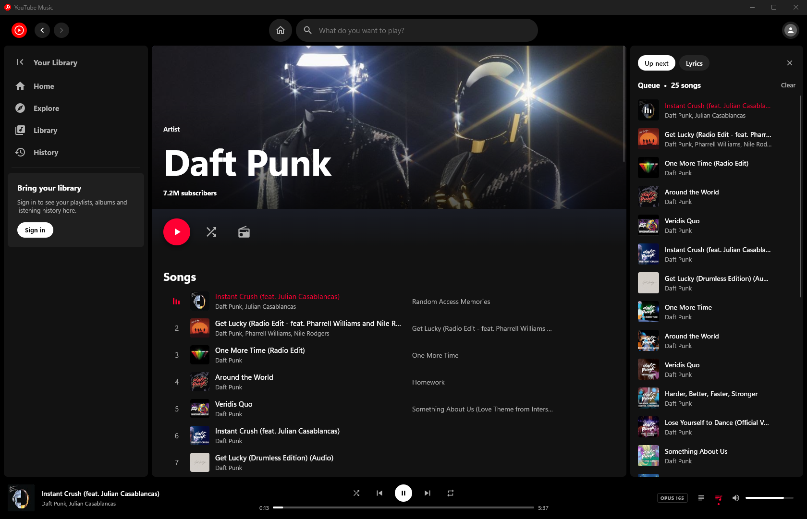</td>
<td width="50%">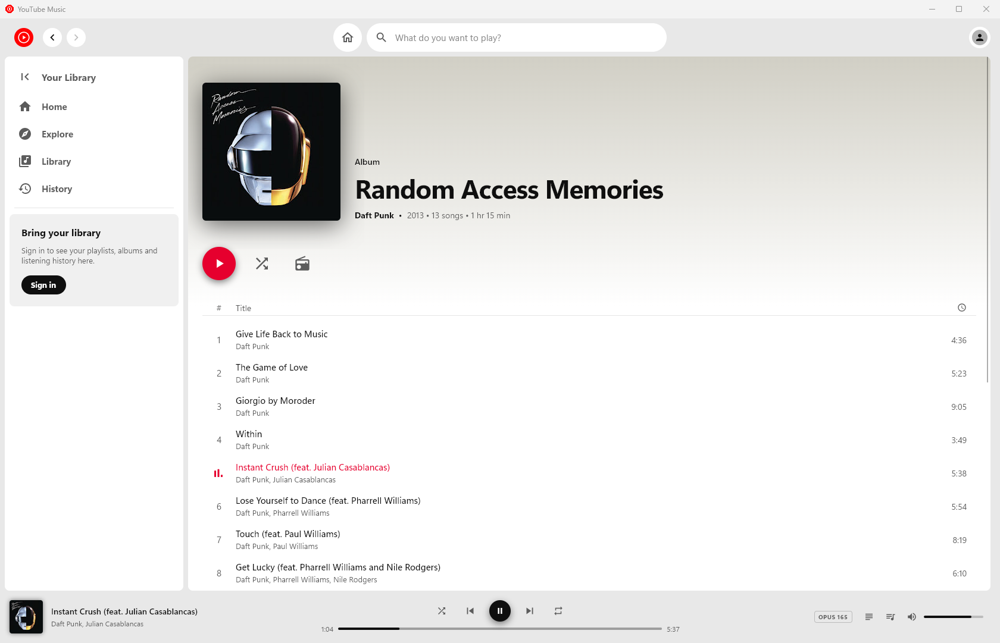</td>
</tr>
<tr>
<td align="center"><b>Dark</b> · artist pages with the queue beside them</td>
<td align="center"><b>Light</b> · album pages tinted from the cover</td>
</tr>
<tr>
<td width="50%">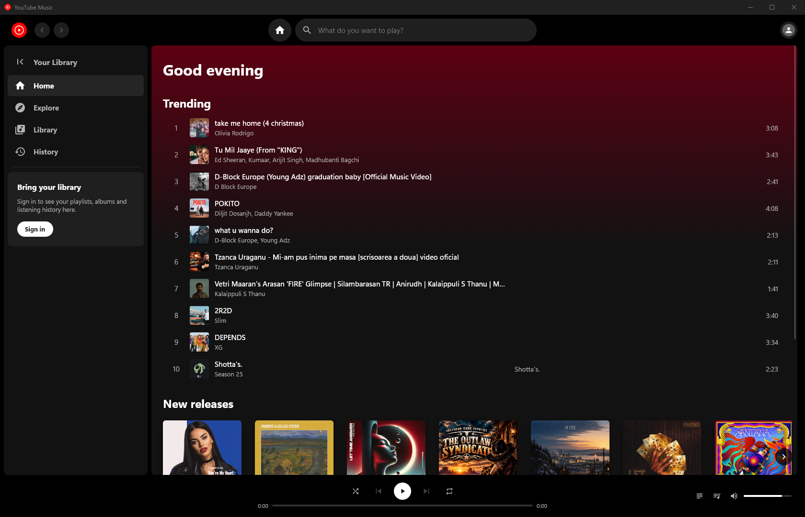</td>
<td width="50%">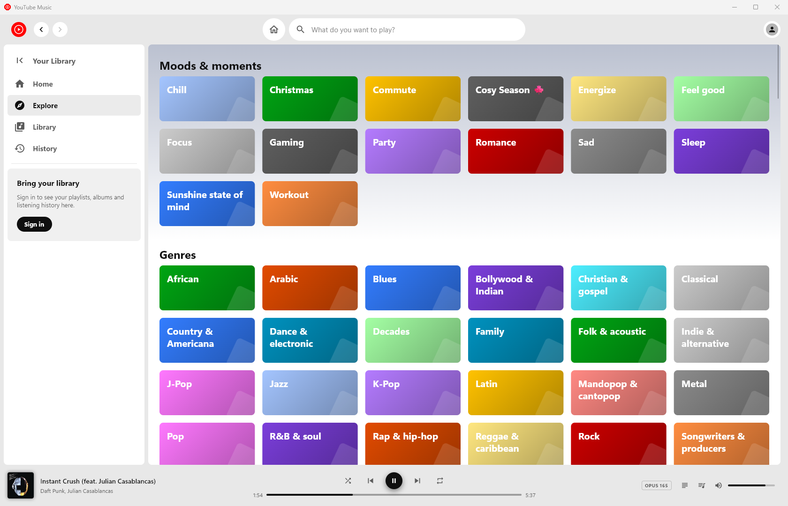</td>
</tr>
<tr>
<td align="center"><b>Home</b> · tinted with your accent</td>
<td align="center"><b>Explore</b> · moods, genres and new releases</td>
</tr>
</table>

Pick a look and an accent in **Settings ▸ Appearance**: Red, Orange, Green, Teal, Blue, Purple, Pink, or **From the artwork**.

## Sounds as good as YouTube gets

<table>
<tr>
<td width="50%">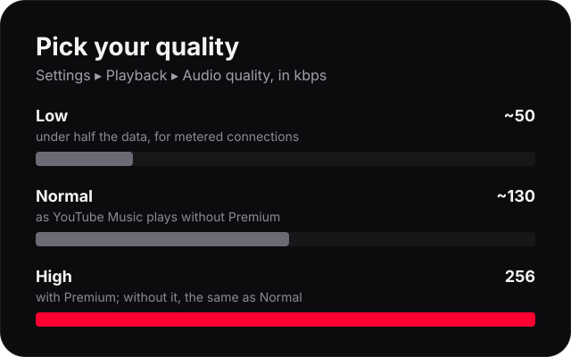</td>
<td width="50%">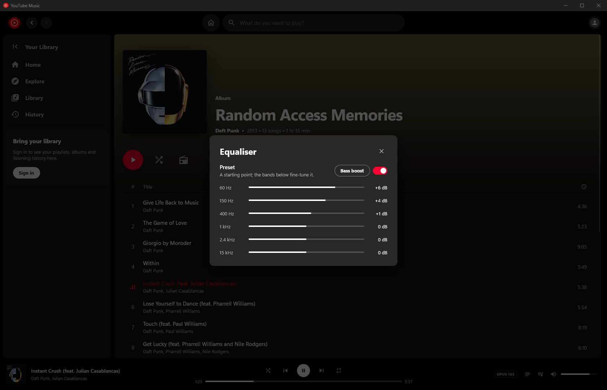</td>
</tr>
</table>

| Feature | What it does |
| --- | --- |
| **Premium streams** | Signed in with Premium on High, songs play in YouTube's 256 kbps formats, and the player bar says so. Music videos swap to their song versions to get them. |
| **Gapless** | The next song is lined up 15 seconds early and follows without a gap, and the screen changes the moment the sound does. |
| **Crossfade** | Fades each song into the next over 6 seconds, cutting the silence at the joins. An album played in order still runs straight on, and skipping never fades. |
| **Equaliser** | Six bands from 60 Hz to 15 kHz, ±12 dB each, with presets: Flat, Bass boost, Treble boost, Vocal, Rock, Electronic and Acoustic. Boosting turns the rest down to leave headroom. |
| **Normalise volume** | Plays every track at a similar loudness, from YouTube's own measurement, as YouTube Music does. |
| **No clicks, no drop-outs** | Pausing ramps the sound down, and seeks and skips fade in. Unplug your headphones and the music carries on through the next device. |

## Light enough to forget about

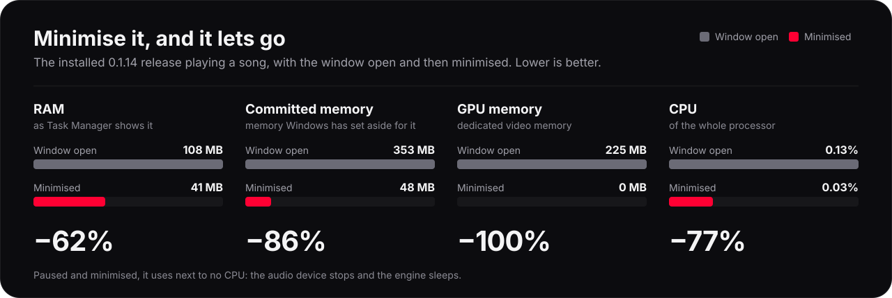

When you minimise it, the app throws away its GPU surface and drawing caches, and builds them again the moment you bring it back. Pause the music and the audio device stops too, so the app sleeps and Windows can as well.

<details>
<summary><b>How these were measured</b></summary>
<br>

The installed 0.1.14 release on Windows 11 (16 logical processors), signed in with Premium, sampled with Windows' own performance counters after each state had settled.

| State | RAM (Task Manager) | Committed | GPU memory | CPU | CPU, one core |
| --- | ---: | ---: | ---: | ---: | ---: |
| Home open, nothing playing | 95 MB | 274 MB | 161 MB | 0% | 0% |
| Playing, window open | 108 MB | 353 MB | 225 MB | 0.13% | 2.0% |
| Playing, minimised | 41 MB | 48 MB | 0 MB | 0.03% | 0.5% |
| Paused, minimised | 41 MB | 49 MB | 0 MB | 0% | 0.1% |

RAM is the private working set, the figure Task Manager's Memory column shows. Committed is private bytes. GPU memory is dedicated video memory.

</details>

## Install

Grab one from the [latest release](https://github.com/Visxoz/ytm-native/releases/latest):

<table>
<tr>
<td width="50%" valign="top">

**Installer** · `ytm-native_<version>_x64-setup.exe`

Installs for your account only, with no admin prompt, a Start menu entry and an uninstaller.

</td>
<td width="50%" valign="top">

**Portable** · `ytm-native_<version>_x64-portable.exe`

Put it anywhere and run it. Nothing is installed.

</td>
</tr>
</table>

Both keep themselves up to date. When a new version is out, a dot appears on the account button, and **Settings ▸ About ▸ Updates** installs it and restarts. Every download is checked against the release's SHA-256 checksums first.

> [!NOTE]
> The app isn't code-signed yet, so SmartScreen may say it "protected your PC": choose **More info**, then **Run anyway**. If Smart App Control blocks it, right-click the file, choose **Properties**, tick **Unblock**, and run it again.

## Shortcuts

| Keys | Does |
| --- | --- |
| <kbd>Space</kbd> | Play or pause |
| <kbd>Ctrl</kbd> <kbd>←</kbd> / <kbd>Ctrl</kbd> <kbd>→</kbd> | Previous or next song |
| <kbd>Ctrl</kbd> <kbd>K</kbd> | Search (<kbd>Ctrl</kbd> <kbd>F</kbd> and <kbd>Ctrl</kbd> <kbd>L</kbd> work too) |
| <kbd>Ctrl</kbd> <kbd>B</kbd> | Collapse or expand the library sidebar |
| <kbd>Alt</kbd> <kbd>←</kbd> / <kbd>Alt</kbd> <kbd>→</kbd> | Back or forward |
| <kbd>Delete</kbd> | Remove the songs picked in the queue |
| <kbd>Esc</kbd> | Close a dialog, or clear the queue's selection |

Right-click a song to play it next, add it to the queue, start a radio, like it, save it to a playlist, or go to its artist or album. In the queue, <kbd>Ctrl</kbd>-click and <kbd>Shift</kbd>-click pick several songs at once.

## Your account

Choose **Sign in** in the sidebar (or in **Settings ▸ Account**), then **Sign in with Google**, and sign in on Google's own page. The window closes by itself once you're in. Your playlists and Liked music appear in the sidebar, your albums and artists in Library, Home becomes your own feed, and what you play here counts towards your YouTube Music history and recommendations.

The sign-in is stored encrypted for your Windows account only, with DPAPI. Signing in uses Microsoft Edge WebView2, which comes with Windows 11 and most Windows 10 PCs.

<details>
<summary><b>Prefer pasting cookies?</b></summary>
<br>

Open music.youtube.com in a private browser window and sign in. Copy either a cookies.txt export or the `Cookie` request header from the developer tools (Network tab), paste it under **Paste cookies instead**, and close the private window. YouTube rotates the cookies of sessions that stay open.

</details>

> [!WARNING]
> ytm-native is an unofficial client. It uses YouTube's undocumented API, which is against YouTube's terms of service. Google could ask you to confirm you're not a bot or sign the session out, and could in principle restrict the account. A separate account is the safest choice.

## Under the hood

Everything you see and hear is native code, written in Rust. A browser engine only appears while you sign in, to show Google's page.

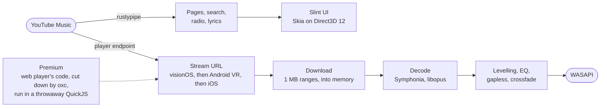

<details>
<summary><b>What it's built with</b></summary>
<br>

| Part | Built with |
| --- | --- |
| YouTube Music data | [rustypipe](https://codeberg.org/ThetaDev/rustypipe) |
| Stream URLs | YouTube's player endpoint, called directly (`src/streams`) |
| Premium URLs | [oxc](https://oxc.rs) and [QuickJS](https://github.com/DelSkayn/rquickjs) |
| Demuxing and AAC | [Symphonia](https://github.com/pdeljanov/Symphonia) |
| Opus | libopus 1.3.1, as Rust ([unsafe-libopus](https://crates.io/crates/unsafe-libopus)) |
| Audio output | [cpal](https://github.com/RustAudio/cpal), through WASAPI |
| Interface | [Slint](https://slint.dev), drawn by Skia on the GPU through Direct3D 12 |
| Networking | reqwest over Windows SChannel and HTTP/2, on Tokio |
| Google sign-in | WebView2 through [wry](https://github.com/tauri-apps/wry), only while signing in |
| Media keys | [souvlaki](https://github.com/Sinono3/souvlaki) |

Most YouTube clients get stream URLs that YouTube's player JavaScript has to unscramble. The visionOS client gets plain ones, so the app asks as that client and needs no JavaScript engine, falling back to Android VR and iOS if YouTube changes it. A daily check flags it when one of them stops working. With Premium, the app unscrambles the web player's URLs itself, in a short-lived QuickJS context with a cut-down copy of the player.

The app talks only to YouTube's hosts, plus GitHub for updates and Last.fm if you connect it, each checked against an allowlist. It keeps everything in `%APPDATA%\ytm-native`.

</details>

<details>
<summary><b>Building from source</b></summary>
<br>

You need Rust with the MSVC toolchain. Three crates are built from `vendor/` with a patch from `patches/` applied, so vendor them once after cloning, and again after updating Slint or rustypipe:

```powershell
./scripts/vendor-patched.ps1
```

```powershell
cargo run              # debug build with logging
cargo build --release  # target/release/ytm-native.exe
cargo test
```

The patches:

- `i-slint-common` memory-maps the fallback fonts instead of reading them into memory.
- `i-slint-renderer-skia` draws those fonts from the mappings, and drops its GPU surface and caches while the window is minimised.
- `rustypipe` opens playlists the signed-in user owns, fetches visitor IDs from YouTube's API rather than the Music home page, and returns an error instead of crashing when YouTube refuses one.

`YTM_LOG=info` turns on logging in release builds.

</details>

## Licence

ytm-native is free software under the [GNU General Public License, version 3](LICENSE). It builds on [rustypipe](https://codeberg.org/ThetaDev/rustypipe), which is GPL-3.0, and on [Slint](https://slint.dev) under its GPL-3.0 option.

<br>

<div align="center">
<sub>Not affiliated with, endorsed by or connected to YouTube or Google. YouTube Music is a trademark of Google LLC.</sub>
</div>
